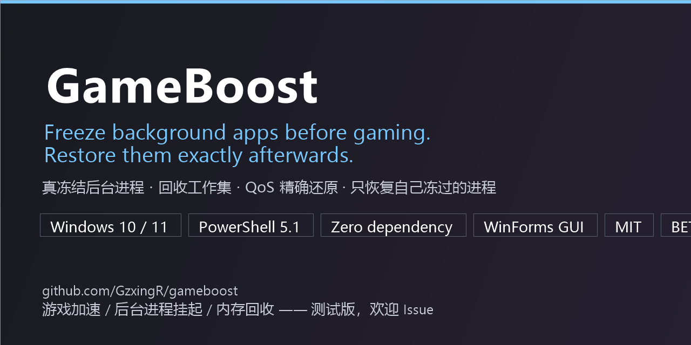

# GameBoost — freeze background apps before gaming, restore them exactly

**English** | [简体中文](README.zh-CN.md)

[](LICENSE)
[](#requirements)
[](#requirements)
[](CHANGELOG.md)
[](#-this-is-a-beta)
[](#requirements)
[](tests/Test-GameBoost.ps1)
[](https://github.com/GzxingR/gameboost/actions/workflows/ci.yml)
[](../../issues/new/choose)

[](https://gzxingr.github.io/gameboost/)

> Browsers, chat clients, sync tools and vendor panels keep eating **CPU time, RAM and disk I/O**
> while you play. GameBoost **freezes** them (not kills — every tab, session and document stays intact)
> and reclaims the memory they hold, then **restores priority, memory priority and EcoQoS state exactly**
> as they were. Zero dependencies: pure PowerShell 5.1 plus a WinForms GUI.

**Keywords**: game booster, freeze background processes, suspend process, process suspension, RAM cleaner,
memory optimization, working set trim, efficiency mode, EcoQoS, process priority, game launcher cleanup,
Windows 10, Windows 11, PowerShell, NtSuspendProcess, EmptyWorkingSet, Process Lasso alternative,
SceneShift alternative.

<details>
<summary>Table of contents</summary>

- [⚠️ This is a BETA](#-this-is-a-beta)
- [Why](#why)
- [Features](#features)
- [Requirements](#requirements)
- [Quick start](#quick-start)
- [GUI](#gui)
- [CLI](#cli)
- [Safety model](#safety-model)
- [Comparison](#comparison)
- [Benchmarks](#benchmarks)
- [Known limitations](#known-limitations)
- [FAQ](#faq)
- [How it works (internals)](#how-it-works-internals)
- [Contributing](#contributing)
- [Credits](#credits)
- [License](#license)

</details>

## ⚠️ This is a BETA

Early build. **It really does suspend your processes**, so read the docs first and try `-DryRun`.
Bugs, wrong freezes, missing freezes and incomplete restores are all **welcome as issues** — for a project
like this, real feedback is worth more than stars. See [CONTRIBUTING.md](CONTRIBUTING.md).

## Why

- A game wants **CPU time + physical RAM + disk I/O**; background apps quietly compete for all three.
- Most "game boosters" tweak the registry, stop services and clear caches — vaguely beneficial and hard to undo.
  GameBoost is **fully reversible**: freeze → restore, with a journal of everything it touched.
- Unlike similar tools, the emphasis here is **"never freeze the wrong thing"** (see [safety model](#safety-model)).

## Features

| Feature | What it does |
|---|---|
| 🧊 **Real freeze** | `NtSuspendProcess` suspends every thread — CPU usage drops to zero, state is preserved |
| 💾 **Memory reclaim** | `EmptyWorkingSet` hands the frozen app's working set back to the system |
| ♻️ **Exact restore** | Priority, memory priority and EcoQoS are snapshotted before freezing and written back verbatim (verified: `0x20/5/0` → `0x40/1/1` → `0x20/5/0`) |
| 🔒 **Four safety layers** | Critical-process check + hard-coded anti-cheat/AV blocklist + own process chain + fullscreen-foreground guard |
| 🎯 **Restores only what it froze** | `pid + name + start time` fingerprint; recycled PIDs are skipped, never mis-resumed |
| 🖥️ **WinForms GUI** | Scan / tick / freeze / restore / status / live log, with a built-in `-SelfTest` |
| ⏱️ **Auto-recovery** | Hidden watcher resumes automatically when the game exits, or after N minutes |
| 🪶 **Zero dependency** | PowerShell 5.1 + built-in .NET Framework. No Python, no Node, no installers |
| 📉 **Pipelined batch execution** | 18 targets frozen in 1.60 s, restored in 1.08 s (0.097 s per process) |
| 🧪 **Tested** | `tests/Test-GameBoost.ps1`: 44 assertions covering the freeze/restore loop, idempotency, fingerprint protection, QoS restore, GUI self-test |
| 🔁 **CI** | GitHub Actions: PSScriptAnalyzer + the full test suite on `windows-latest` |

## Requirements

| Item | Requirement |
|---|---|
| OS | Windows 10 / 11 x64 (**fully tested only on Windows 11 + PowerShell 5.1**; other combos unverified) |
| PowerShell | 5.1 (bundled) or 7.x |
| Privileges | **Administrator recommended** (needed for cross-session/high-privilege targets; same-user apps work unelevated) |
| Dependencies | **None.** The GUI uses the bundled .NET Framework 4.x WinForms |

## Quick start

```powershell
git clone https://github.com/GzxingR/gameboost.git
cd gameboost

# 1) See exactly what it would touch (changes nothing)
.\pause-non-system-processes.ps1 -DryRun

# 2) Freeze background apps (Safe allow-list by default)
.\pause-non-system-processes.ps1 -Yes

# 3) Restore everything when you are done
.\resume-non-system-processes.ps1 -Yes
```

Run the self-test suite at any time (it only freezes a synthetic process it starts itself):

```powershell
.\tests\Test-GameBoost.ps1
```

## GUI

Double-click `GameBoost.GUI.cmd`, or run `Install-GameBoostShortcuts.ps1` to create desktop shortcuts and hotkeys:
**Ctrl+Alt+G** console · **Ctrl+Alt+P** freeze · **Ctrl+Alt+R** restore.

```
  ┌─ GameBoost console ────────────────────────────────────────────┐
  │ Status: no frozen session        [administrator]               │
  │ Mode [Suspend ▼]   Scope [Safe allow-list ▼]                   │
  │      [ ] include host/editor processes   [ ] skip visible windows
  │ Auto-restore  [ ] game process [________]  or [ ] after [120] min
  │ [Scan F5][Freeze selected F9][Restore all F10][Status][Open dir]│
  │ ┌───────────────────────────────────────────────────────────┐  │
  │ │ Name          procs   RAM MB   session   state             │  │
  │ │ chrome           51     4778      1      freezable         │  │
  │ │ MsMpEng           1      473      0      protected (AV)    │  │
  │ │ ACE-Tray          1      —        1      protected (anti-cheat)
  │ └───────────────────────────────────────────────────────────┘  │
  └────────────────────────────────────────────────────────────────┘
```

Protected rows are greyed out and **cannot be ticked** (anti-cheat, antivirus, critical system processes,
session-0 services, your editors/hosts).

> The hotkeys matter: if you also freeze the terminal or your editor, the hotkey is your only way back.

## CLI

| Parameter | Meaning |
|---|---|
| `-Scope Safe` (default) | Only processes matching `safeTargets` in `config.json` |
| `-Scope Broad` | All **user-session** processes (session-0 services are never touched) |
| `-Mode Suspend` (default) | Real freeze: `NtSuspendProcess` + working-set reclaim |
| `-Mode Idle` | Zero-risk soft mode: Idle priority + `MEMORY_PRIORITY_VERY_LOW` + EcoQoS, no freeze |
| `-Only <name[]>` / `-NamesFile <path>` | Restrict to specific process names (the file variant exists to dodge PowerShell's native-argument quoting) |
| `-Exclude <name[]>` / `-Game <name>` | Extra protection |
| `-BoostGame <name>` | Raise a game to HIGH priority (original value restored later) |
| `-IncludeAgent` / `-IncludeShell` | Allow freezing host/editor processes / terminal family and `explorer` (**not recommended**) |
| `-SkipVisible` | Skip processes that own a visible window (avoids "hung" windows) |
| `-NoChildren` / `-NoTrim` | Don't include child processes / don't reclaim working sets |
| `-ReSuspend` | Double-freeze processes that still have runnable threads (journal records `suspendCount=2`) |
| `-AutoResumeMinutes <n>` / `-ResumeWhenProcessExits <name>` | Spawn a hidden watcher: restore after N minutes / when the target fully exits |
| `-DryRun` / `-Yes` / `-Quiet` / `-DefenderHint` | Preview / no prompt / quiet / print a Defender hint |
| `-EmitJson` / `-JsonOut <path>` | Emit the scan list as JSON (the GUI reuses the same decision logic) |

Resume script: `-Status`, `-DryRun`, `-Force` (ignore fingerprint), `-KeepJournal`.

## Safety model

1. **`IsProcessCritical`** — critical processes are skipped.
   *Known limitation*: it returns True for `csrss/services/wininit`, but **False for `System` and `lsass`**,
   so a name blocklist is required as well.
2. **Hard-coded blocklist** — system components plus **anti-cheat and antivirus** (Windows Defender, Tencent ACE,
   EasyAntiCheat, BattlEye, Vanguard, security agents…). `config.json` and CLI parameters **cannot** lift it.
   Reason: suspending anti-cheat crashes games or gets you banned; suspending AV is a behaviour that EDR products
   explicitly flag as malicious.
3. **Own process chain** — the script's ancestors and descendants are never frozen; the terminal family and
   `explorer.exe` are protected by default.
4. **Fullscreen-foreground guard** — whatever owns the fullscreen foreground window is excluded at freeze time.

Plus: **restores only what it froze** (fingerprint), **session-0 services untouched by default** (`skipSession0`),
and **no registry writes, no service changes, no power-plan changes, no AV changes, no network access**.

## Comparison

| Tool | Focus | Relation to this project |
|---|---|---|
| **Process Lasso** (closed) | Long-term priority/affinity (ProBalance) | Doesn't freeze; can coexist |
| **Mem Reduct** / **WinMemoryCleaner** (open) | Memory reclaim (working sets, standby list) | Reclaim only; GameBoost freezes **first**, then reclaims |
| **SceneShift** (open, TUI) | Suspend/kill background apps from a terminal UI | Same idea. GameBoost adds the AV/anti-cheat blocklist, pid fingerprints, exact QoS snapshots and a two-phase auto-restore watcher |
| **System Informer** (open, GUI) | Full system inspection/management | Can do all of it manually, but has no "one hotkey before gaming" workflow |
| **Task Manager "Efficiency mode"** (built-in) | Per-process EcoQoS | GameBoost does it in bulk and additionally freezes + reclaims memory |
| "Game boosters" (closed) | Registry tweaks, service stopping, cache clearing | GameBoost is **fully reversible** and journals everything |

## Benchmarks

Test machine: Windows 11, 16 logical CPUs, 15.3 GB RAM, NVMe SSD, PowerShell 5.1.

| Metric | Result |
|---|---|
| `-Scope Safe` dry run | 146 processes / 31 names, ≈ 8–10 GB working set |
| Freezing 18 targets | **1.60 s** (8.63 s before the pipelining optimisation) |
| Restoring 18 targets | **1.08 s** (3.30 s before) |
| Per-process cost | **0.097 s** |
| Freeze verification | thread count `susp=N/N`; CPU delta over 3 s = 0 ms |
| Memory benchmark (`tools/MemBalloon.cs`, 2048 MB of dirty pages) | working set 2067 MB → **0 MB**; free physical memory **+1017 MB after 5 s (~50%)**, the rest returns as the system idles; page file usage +3.6 GB |

**Expectation management**: the "N MB to reclaim" figure printed by the tool is a **working-set estimate**, not
memory that is instantly free. Dirty pages must be written back to the page file first, so release is
**asynchronous and roughly half-immediate**. Freeze *before* launching the game, otherwise the write-back competes
with the game's loading I/O on the same disk.

## Known limitations

- **Frozen windows appear hung/greyed** until restored — inherent to suspension. Use `-Mode Idle` or `-SkipVisible` if that bothers you.
- **WeChat / cloud-sync clients** stop receiving messages or syncing while frozen (shipped in `idleByDefault`: they only get a lower QoS, never frozen).
- **Office / WPS** frozen mid-autosave may lose recent edits (same soft-mode treatment by default).
- **UWP / Store apps** cannot be suspended (Windows restriction).
- A few processes own `BYPASS_PROCESS_FREEZE` threads and may keep burning a little CPU — the tool **measures and reports this honestly**; use `-ReSuspend` if needed.
- `NtSuspendProcess` is an undocumented native API that suspends threads one by one, so **races are theoretically possible**; resume must use the same API family (never mix with `SuspendThread`).
- Antivirus software may look twice at "bulk process suspension" (the same primitive has been abused by malware). The scripts are plain text, touch no security component, and log everything. Whitelist if needed.
- Freezing consumes page-file space (dirty pages), so avoid bulk freezing on a nearly full disk.
- **Not verified** on Windows 10, ARM64 or PowerShell 7.

## FAQ

<details><summary><b>Could it freeze my game or the anti-cheat?</b></summary>

No. Four layers of protection (see [safety model](#safety-model)); anti-cheat and AV processes are in a hard-coded
blocklist that neither `config.json` nor CLI flags can lift.
</details>

<details><summary><b>How is this different from ending a process?</b></summary>

Suspending keeps all memory and state, it just denies CPU time. Tabs, chat history and documents survive.
GameBoost never terminates anything by default.
</details>

<details><summary><b>How much memory does it actually free?</b></summary>

Measured: a 2067 MB dirty working set is trimmed to 0 MB, and free physical memory rises by ~1 GB within 5 s
(≈50%), with the rest returning as the system idles. Run it **before** starting the game; if the game is already
running, use `-Mode Idle` (no disk writes).
</details>

<details><summary><b>Why do windows freeze or turn grey?</b></summary>

A suspended process cannot answer window messages, so Windows paints it as "not responding". Restoring fixes it and
nothing is lost. `-SkipVisible` avoids the situation entirely.
</details>

<details><summary><b>I forgot to restore — what now?</b></summary>

Run `resume-non-system-processes.ps1 -Force`, or just reboot: **suspension does not survive a restart**.
Better: pass `-AutoResumeMinutes 120` or `-ResumeWhenProcessExits <game.exe>` so a hidden watcher cleans up for you.
</details>

<details><summary><b>Is it safe with anti-cheat protected games?</b></summary>

GameBoost never reads or writes game memory, never injects, never modifies game files. It only suspends processes
you selected, and it refuses to touch anti-cheat processes at all.
</details>

## How it works (internals)

| Purpose | API | Notes |
|---|---|---|
| Freeze / resume | `ntdll!NtSuspendProcess` / `NtResumeProcess` | Needs `PROCESS_SUSPEND_RESUME (0x0800)`; **must be paired** (suspend count is tracked in the journal) |
| Reclaim memory | `psapi!EmptyWorkingSet` | Needs `PROCESS_QUERY_INFORMATION (0x0400)` + `PROCESS_SET_QUOTA (0x0100)` |
| Critical check | `kernel32!IsProcessCritical` | Needs `PROCESS_QUERY_LIMITED_INFORMATION (0x1000)` |
| Read/write QoS | `GetProcessInformation` / `SetProcessInformation` | `ProcessMemoryPriority = 0`, `ProcessPowerThrottling = 4`; throttle flags `CURRENT_VERSION = 1`, `EXECUTION_SPEED = 0x1` |

The handle mask `0x0F00` is attempted first and **falls back to `0x1800`** for protected targets; in fallback mode
working-set reclaim is skipped so the tool never reports a fake success. Details, constant sources (Windows SDK
`processthreadsapi.h`, phnt/NtDoc) and the pitfalls found while building this are in
[docs/TECHNICAL.md](docs/TECHNICAL.md).

## Contributing

This is a beta and the most valuable contributions are **real reports**: a process that was frozen but shouldn't
have been, one that should have been frozen but wasn't, or an incomplete restore. See
[CONTRIBUTING.md](CONTRIBUTING.md) and the issue templates.

External listing/submission material (and one target that explicitly forbids AI-authored PRs) is documented in
[docs/BACKLINKS.md](docs/BACKLINKS.md).

## Credits

- No third-party binaries are bundled. Comparable tools mentioned above live in their own repositories.
- API behaviour and constants: Microsoft Learn (`SetProcessInformation`, `PROCESS_POWER_THROTTLING_STATE`,
  `MEMORY_PRIORITY_INFORMATION`, `EmptyWorkingSet`, process access rights), the Windows SDK header
  `processthreadsapi.h`, and System Informer's phnt native API docs (NtDoc) — including the two caveats that
  shaped this design: `NtSuspendProcess` suspends threads one by one (races), and it ignores threads created with
  `THREAD_CREATE_FLAGS_BYPASS_PROCESS_FREEZE`.

## License

MIT (see [LICENSE](LICENSE)). Use at your own risk — it genuinely suspends your processes.

See the engineering write-up: [为什么用 PowerShell 做一个"冻结"工具，以及 5 个坑](docs/articles/01-engineering-notes.md)（中文）.
